### `khsos@github ~ $ ./contributions.sh`

 

### `khsos@github ~ $ whoami`

<table><tr>
<td valign="top"></td>
<td valign="top"></td>
</tr></table>

 

Layout inspiration: <a href="https://github.com/AVIVASHISHTA29/AVIVASHISHTA29">AVIVASHISHTA29</a>. Artwork and generators independently implemented for KHSOS.

